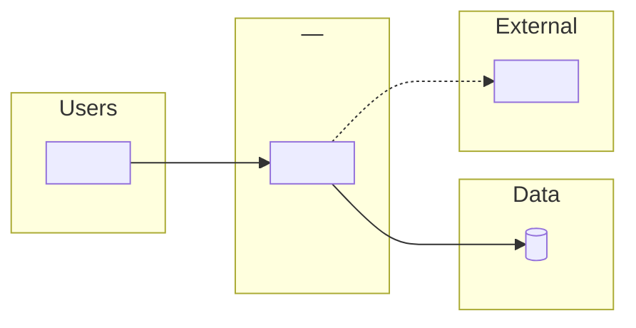

# Skill: Discovery Dossier Template

> The structured narrative output of the Discovery Engineer. Pairs with the Capability Matrix (machine-readable) — this is the human-readable equivalent.

## Output File

`reports/Discovery-Dossier.md`

## When to Use

- At the end of `/assess-any-application`
- Whenever a new application enters the system
- When existing classification needs to be re-documented after additional probes

## Template

````markdown
# Discovery Dossier — <Application Name>

> Produced by: Discovery Engineer
> Date: <YYYY-MM-DD>
> Status: <Draft | Approved by Architect | Refined>

## 1. Executive Summary (≤5 lines)

<5 lines covering: what the app does, where it runs today, what stack, primary risk, recommended strategy>

**Size:** <total LOC> lines of code (<method>) · **Migration complexity:** <Low | Medium | High | Very High> (score <NN>/100) · **Estimated effort:** <min>–<max> weeks (<AI-assisted | traditional>)<, provisional>

## 2. Application Identity

| Field | Value |
|-------|-------|
| Name | <name> |
| Business owner | <person or "unknown"> |
| Purpose | <one-line description> |
| Current users | <approximate count or "unknown"> |
| Criticality | <mission-critical | important | nice-to-have> |
| Business priority | <speed | modernize | cost | risk> |

## 3. Source Profile

**Primary source adapter:** `<adapter name>`
**Access method:** `<git-url | aws-profile | file-path | rvtools-export | describe-only>`
**Evidence confidence:** `<high | medium | low>`

### Evidence

- <file path or command output 1>
- <file path or command output 2>
- ...

### Notes

<any caveats: inaccessible regions, partial source, vendor binaries mixed in>

## 4. Stack Profile

**Primary stack:** `<dotnet | java | python | nodejs | php | ruby | go | perl | rust | oracle-forms | powerbuilder | delphi-vb6 | scala-kotlin | cpp-windows>`
**Primary framework:** `<framework + version>`
**Build system:** `<msbuild | maven | gradle | npm | pip | composer | cargo | go-modules | ...>`
**Runtime version detected:** `<e.g., dotnet8.0, java-17, python-3.11>`
**Evidence confidence:** `<high | medium | low>`

### Code Size (Lines of Code)

**Total:** <N> non-blank lines (excluding vendored, generated and minified files) · **Test code:** <N | unknown> · **Method:** `<scc | cloc | pwsh-fallback | bash-fallback | object-count | user-estimate>`

| Language | Files | Lines of code | Share |
|----------|-------|---------------|-------|
| <e.g., C#> | <n> | <n> | <%> |
| <e.g., JavaScript> | <n> | <n> | <%> |

### Secondary Stacks

| Stack | Share | Role |
|-------|-------|------|
| <name> | <%> | <build / scripts / migration / UI> |

### Top External Dependencies

| Library | Version | Notes |
|---------|---------|-------|
| <name> | <version> | <e.g., needs Azure-compatible replacement> |

## 5. Workload Profile

**Primary pattern:** `<webapp | api-service | batch-job | event-driven | serverless | desktop-client-server | packaged-app | data-pipeline>`
**Secondary patterns:** <list or "none">

### Entry Points

- <main(), web entry, scheduled job, message consumer, CLI binary>

### Runtime Topology

- Single binary / process / container / cluster / monolith / microservices / functions / hybrid

## 6. Data Profile

**Primary datastore:** `<sql-server | oracle | postgresql | mysql | mongo | dynamodb | files | s3 | ...>`
**Version:** `<server version>`
**Approximate size:** `<X GB | unknown>`
**Data gravity:** `<none | small (<1 GB) | medium (1-100 GB) | large (100 GB - 1 TB) | very-large (>1 TB)>`
**Evidence confidence:** `<high | medium | low>`

### Schema Highlights

- <key tables, stored procedure count, complex constraints>

### Data Migration Constraints

- <replication, reporting consumers, downtime tolerance>

## 7. Integration Map

| Integration | Direction | Protocol | Criticality | Notes |
|-------------|-----------|----------|-------------|-------|
| <name> | <in | out | both> | <REST | SOAP | SFTP | JMS | AMQP | SMB | ...> | <high | med | low> | <e.g., "external customer-facing API"> |

### Current Architecture Diagram

Mermaid source, also saved as `reports/diagrams/current-architecture.mmd` and rendered into the HTML report. Use `flowchart LR` with subgraphs (users, application, data, external services) so the diagram stays readable; one node per component in §3, §6 and the table above.



### Identity Provider

- Current: <AD | LDAP | SAML | OAuth | custom | hardcoded>
- Target: <Entra ID workload identity | Entra ID B2C | preserve existing>

### Network Dependencies

- <private endpoints, VPN, firewall rules, on-prem systems referenced>

## 8. Risks & Compliance Flags

| Flag | Description | Implication |
|------|-------------|-------------|
| `<risk_flag>` | <reason it was set> | <which specialist is added; which gate fires> |

## 9. Migration Strategy Recommendation

**Recommended strategy:** `<rehost | replatform | refactor | rearchitect | rebuild | retire | retain>`

### Decision Path (from `migration-strategy-decision-tree`)

1. <Branch X: result>
2. <Branch Y: result>
...

### Alternatives Considered

| Alternative | Rejected because |
|-------------|------------------|
| <other 6R> | <reason> |
| <other 6R> | <reason> |

### Rationale (3–5 lines)

<the human-readable summary of why this strategy beats the alternatives for THIS application>

## 10. Migration Complexity & Effort

> Method: `.github/skills/migration-artifacts/references/complexity-model.md` · Model version: `<model_version>`

**Complexity level:** `<Low | Medium | High | Very High | not-estimated>` · **Score:** <NN>/100 (score alone → <score_level>)
**Delivery model:** <AI-assisted (<tooling>) | Traditional> · **Without AI assistance:** <score> (<level>), <min>–<max> weeks <omit when traditional>
**Floor rules applied:** <rule ids, or "none">
**Estimated effort:** **<min>–<max> weeks** (<strategy> × <factor>)<, provisional — see widened streams> for <baseline_team>

| Dimension | Rating (1–5) | Adjusted | Weight | Evidence | Confidence |
|-----------|--------------|----------|--------|----------|------------|
| Code size | <n> | <n> | 0.20 | <N lines of code via <method>> | <h/m/l> |
| Stack & runtime gap | <n> | <n> | 0.15 | <evidence> | <h/m/l> |
| Integrations | <n> | <n> | 0.15 | <count, legacy protocols> | <h/m/l> |
| Data | <n> | <n> | 0.15 | <evidence> | <h/m/l> |
| Architecture, state & jobs | <n> | <n> | 0.10 | <evidence> | <h/m/l> |
| Azure compatibility blockers | <n> | <n> | 0.10 | <evidence> | <h/m/l> |
| Identity, security & compliance | <n> | <n> | 0.10 | <evidence> | <h/m/l> |
| Delivery readiness & cutover | <n> | <n> | 0.05 | <evidence> | <h/m/l> |
| **Weighted rating** | | **<x.xx>** | | | |

**Top drivers:** <2–3 plain-language drivers>

### Effort Breakdown

Where the <min>–<max> weeks go (method: complexity-model.md Step 5). Team-days = weeks × 5 for the baseline team.

| Work stream | Main-path phase | Stream rating | Share | Team-days | AI leverage |
|-------------|-----------------|---------------|-------|-----------|-------------|
| Assessment, decisions & detailed plan | Phase 1 | <x.xx> | <p>% | <min>–<max> | medium |
| Code & configuration migration | Phase 2 | <x.xx> | <p>% | <min>–<max> | high |
| State, jobs & Azure-blocker remediation | Phase 2 | <x.xx> | <p>% | <min>–<max> | high |
| Integration rework & connectivity | Phase 2 | <x.xx> | <p>% | <min>–<max> | medium |
| Identity, secrets & compliance controls | Phase 2 | <x.xx> | <p>% | <min>–<max> | medium |
| Data migration & validation | Phase 4 (/database-migration) | <x.xx> | <p>% | <min>–<max><, widened> | low |
| Infrastructure as code & CI/CD | Phase 3 + Phase 5 | <x.xx> | <p>% | <min>–<max> | high |
| Testing & validation | Phase 2–4 | <x.xx> | <p>% | <min>–<max> | medium |
| Deployment, cutover & hypercare | Phase 4 + Phase 6 | <x.xx> | <p>% | <min>–<max> | low |

**Widened for low confidence:** <stream names and the low-confidence dimension, or "none">

**Effort covers:** <effort_scope.includes> · **Excludes:** <effort_scope.excludes>

## 11. Target Azure Candidates

| Order | Service | Fit | Notes |
|-------|---------|-----|-------|
| 1 | <e.g., Azure Container Apps> | high | <one-line fit reason> |
| 2 | <e.g., Azure App Service> | medium | <one-line fit reason> |
| 3 | <e.g., AKS> | low | <one-line fit reason> |

> The Architect picks the final target and SKU. Discovery Engineer only proposes candidates.

## 12. Required Specialists (for execution)

| Specialist | Why required |
|------------|--------------|
| Architect | <always> |
| Azure Specialist | <always> |
| Coder | <if any code change> |
| Database Specialist | <if data gravity ≥ medium> |
| Security Auditor | <if regulated-data> |
| Cutover Commander | <if production-only or tight cutover> |
| ... | ... |

## 13. Unresolved Questions

| # | Question | Why it matters | Recommended next probe |
|---|----------|----------------|------------------------|
| Q1 | <question> | <impact> | <action> |
| Q2 | ... | ... | ... |

## 14. Assumptions

- <assumption 1 — if wrong, this is the impact>
- <assumption 2>

## 15. Handoff Note for the Architect

> <3–5 lines summarizing what the Architect needs to do next: approve strategy, pick from candidates, sequence phases, flag any escalations>

---

**Next commands:**
- `/build-migration-plan`
- `/build-migration-plan`
- `@agent open Migration-Orchestrator`
````

## Authoring Rules

1. **Every confidence label is mandatory.** No empty cells.
2. **Every evidence cell points to a file path, command output, or quoted user statement.** No prose-only evidence.
3. **Risk flags must trace to evidence.** "regulated-data" without a why is not acceptable.
4. **Alternatives section must have at least 2 entries.** A recommendation without alternatives is opinion.
5. **No Azure SKU details.** Only services. Architect picks SKUs.
6. **Unresolved questions must include a recommended next probe.** Questions without next steps are dead-ends.
7. **Assumptions must be impact-labeled.** Each assumption says "if wrong, this is the impact."
8. **Lines of code are always reported** (§1 summary line, §4 Code Size table, §10 Code size row) with the counting method. If code is not accessible, record a user estimate with `low` confidence.
9. **Complexity must be explainable.** Every dimension rating cites evidence; any floor rule that raised the level is named; effort always shows its strategy factor, baseline team and scope.
10. **HTML companion.** `reports/Discovery-Report.html` is rendered from the same content using `discovery-report-template.html`. It must not contain facts that are absent from this dossier.

## Quality Gate

A dossier is **complete** when:

- [ ] All 15 sections present
- [ ] Lines of code reported with counting method (§1, §4, §10)
- [ ] §10 complexity table has all 8 dimensions with evidence (rating and adjusted rating), plus level, delivery model, effort weeks and the effort breakdown
- [ ] All confidence labels filled
- [ ] All evidence cells point to specific files or quotes
- [ ] At least 2 alternatives in §9
- [ ] Required specialists trace to matrix signals
- [ ] Handoff note present
- [ ] Capability Matrix at `reports/Capability-Matrix.yaml` matches dossier content
